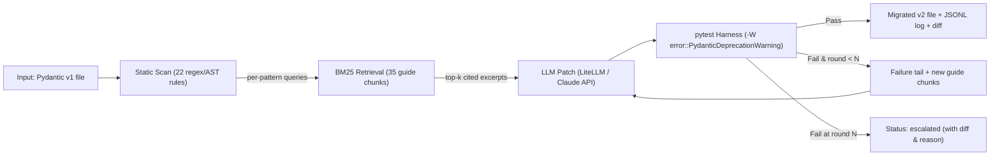

# code-migration-agent

An LLM agent that migrates Python code from **Pydantic v1 to v2**: it finds v1 patterns with a static scan, retrieves matching sections of the official migration guide (BM25 RAG), patches the code, runs `pytest` with deprecation warnings turned into errors, and feeds failures back into a bounded fix loop. An evaluation harness benchmarks the agent against a single-shot LLM call and the rule-based `bump-pydantic` baseline.

> Status: **Steps 1–4 done, step 5 (publish) pending.** On 24 eval cases with `anthropic/claude-haiku-5-5` (2026-11-20): the agent passed 24/24, a single LLM call 20/24, and `bump-pydantic` 4/24. The gap is entirely on the 10 *hard* cases. An ablation shows the **test-driven fix loop** produces it: the agent without retrieval also passed 10/10 in 4 of 4 runs, at about 40% of the cost.

## Why this exists

Version migrations are slow, file-by-file work. Rule-based AST tools handle mechanical syntax changes well (`@validator` → `@field_validator`, `class Config` → `ConfigDict`), while a single LLM call has no way to check its own output. This project tests one claim with real numbers: *a retrieval-grounded, test-driven agent loop migrates more code correctly than a single LLM call or a rule-based tool*, and then measures which part of the loop does the work.

## Architecture



## Eval set

`evals/cases/` holds 24 cases in two sets, each case with:

| File | Purpose |
|---|---|
| `before.py` | Pydantic v1 code to migrate |
| `reference.py` | A correct v2 migration (proves the tests are achievable) |
| `test_case.py` | Behaviour tests, run under Pydantic v2 |
| `meta.json` | Patterns, difficulty, set (`core`/`hard`) and expected guide sections |

Tests run with Pydantic deprecation warnings turned into errors (`-W error::pydantic.warnings.PydanticDeprecationWarning`), so code that only works through `pydantic.v1` or deprecated methods counts as a failure.

- **Core set (01–14):** one or two deprecated v1 APIs per file. These raise deprecation warnings, so they are easy to spot.
- **Hard set (15–24):** v1 code whose behaviour silently changes in v2. After a straightforward rename it runs with **no warning** but returns a different result, which only a test run shows. Examples: `Union[int, str]` no longer turns `"42"` into `42`; an `int` field rejects `2.7` instead of truncating it; `HttpUrl` is no longer a `str`, and `str(url)` adds a trailing `/`; a `TypeError` inside a validator is no longer reported as a `ValidationError`; nested subclass fields are dropped from `model_dump()`. Case 24 is an 80-line module with 8+ interacting patterns. Each behaviour is documented in the migration guide and was confirmed on Pydantic 2.14.3. For every hard case except 21 and 24, a rename-only migration was checked to still fail its tests.

Core-set patterns: `.dict()`/`.json()`, `parse_obj`/`parse_raw`, `@validator` (incl. `pre`/`always`), `@root_validator`, class-based `Config` (`orm_mode`, `allow_population_by_field_name`, `Extra`, `allow_mutation`), implicit `Optional` defaults, `regex=`/`min_items=`, `__root__`, `parse_obj_as`, `.copy()`/`.schema()`, `GenericModel`, `update_forward_refs`.

## Retrieval

The agent grounds each fix in the official [Pydantic V2 migration guide](https://github.com/pydantic/pydantic/blob/91c44cd1bfc8c7cb909cefa8395e0a720957f1d1/docs/migration.md), pinned to one commit (`data/SOURCE.md` has the URL, commit, date and MIT license).

- **Chunking:** one chunk per markdown heading (35 chunks). Each chunk keeps its heading path as its title, e.g. `Migration guide > Changes to config`, so the agent can cite where an instruction came from.
- **Search:** BM25 (`rank-bm25`), zero API cost, with a code-aware tokenizer (`parse_obj_as` is indexed as both the full identifier and split sub-tokens). Optional LiteLLM embedding search is behind `--embeddings`.
- **Whole-file vs. per-pattern queries** (`results/retrieval.json` and `results/retrieval_scan.json`, recall@k = share of a case's expected guide sections found in the top k):

| Query mode | Set | recall@1 | recall@3 | recall@5 |
|---|---|---:|---:|---:|
| Whole `before.py` file | core (14) | 0.536 | 0.929 | 1.000 |
| Whole `before.py` file | hard (10) | 0.170 | 0.423 | 0.443 |
| One query per detected pattern (`scan.py`) | core (14) | 0.893 | **1.000** | 1.000 |
| One query per detected pattern (`scan.py`) | hard (10) | 0.537 | 0.743 | 0.797 |

The per-pattern queries were written by me with the guide in view, so the core-set 1.000 is optimistic. The scan deliberately has no rules for silent behaviour changes, which is why hard-set recall is lower. Those sections have to come from the round-2 search on the test failure text.

## Results

<!-- RESULTS_START -->
| Mode | Model / Tool | Core set | Hard set | All cases | Avg rounds (passed) | Total cost (USD) | Avg latency / case |
|---|---|---:|---:|---:|---:|---:|---:|
| Rule-based (`bump-pydantic`) | `bump-pydantic` | 4/14 | 0/10 | 4/24 (16.7%) | 0 (rule) | $0.00000 | 1.07s |
| Single-shot LLM (no RAG / no loop) | `anthropic/claude-haiku-5-5` | 14/14 | 6/10 | 20/24 (83.3%) | 1.00 | $0.00577 | 2.48s |
| Agent (scan + BM25 RAG + pytest loop) | `anthropic/claude-haiku-5-5` | 14/14 | 10/10 | 24/24 (100.0%) | 1.29 | $0.02041 | 3.19s |
| Ablation: agent without retrieval (scan + pytest loop) | `anthropic/claude-haiku-5-5` | 14/14 | 10/10 | 24/24 (100.0%) | 1.17 | $0.00720 | 2.85s |

<details>
<summary>Per-case breakdown across all 24 eval cases</summary>

| Case | Set | Difficulty | `bump_pydantic` | `single_shot` | `agent` | `agent_no_rag` |
|---|---|---|---|---|---|---|
| `01_dict_json` | core | easy | FAIL (failed) | PASS (r1) | PASS (r1) | PASS (r1) |
| `02_parse_obj_raw` | core | easy | FAIL (failed) | PASS (r1) | PASS (r1) | PASS (r1) |
| `03_validator` | core | easy | PASS | PASS (r1) | PASS (r1) | PASS (r1) |
| `04_validator_pre_always` | core | medium | FAIL (failed) | PASS (r1) | PASS (r1) | PASS (r1) |
| `05_root_validator` | core | medium | FAIL (failed) | PASS (r1) | PASS (r1) | PASS (r1) |
| `06_orm_mode_config` | core | medium | FAIL (failed) | PASS (r1) | PASS (r1) | PASS (r1) |
| `07_optional_implicit_default` | core | medium | PASS | PASS (r1) | PASS (r1) | PASS (r1) |
| `08_field_regex_min_items` | core | easy | PASS | PASS (r1) | PASS (r1) | PASS (r1) |
| `09_custom_root` | core | hard | FAIL (failed) | PASS (r1) | PASS (r1) | PASS (r1) |
| `10_parse_obj_as` | core | medium | FAIL (failed) | PASS (r1) | PASS (r1) | PASS (r1) |
| `11_copy_schema` | core | easy | FAIL (failed) | PASS (r1) | PASS (r1) | PASS (r1) |
| `12_extra_forbid_frozen` | core | medium | FAIL (failed) | PASS (r1) | PASS (r1) | PASS (r1) |
| `13_generic_model` | core | hard | PASS | PASS (r1) | PASS (r1) | PASS (r1) |
| `14_forward_refs` | core | easy | FAIL (failed) | PASS (r1) | PASS (r1) | PASS (r1) |
| `15_union_smart_mode` | hard | hard | FAIL (failed) | PASS (r1) | PASS (r2) | PASS (r1) |
| `16_float_to_int` | hard | hard | FAIL (failed) | FAIL (failed) | PASS (r2) | PASS (r2) |
| `17_number_to_str` | hard | hard | FAIL (failed) | FAIL (failed) | PASS (r2) | PASS (r2) |
| `18_model_dict_equality` | hard | hard | FAIL (failed) | PASS (r1) | PASS (r1) | PASS (r1) |
| `19_url_not_str` | hard | hard | FAIL (failed) | FAIL (failed) | PASS (r2) | PASS (r2) |
| `20_validator_typeerror` | hard | hard | FAIL (failed) | FAIL (failed) | PASS (r2) | PASS (r2) |
| `21_each_item_values` | hard | hard | FAIL (failed) | PASS (r1) | PASS (r1) | PASS (r1) |
| `22_nested_subclass_dump` | hard | hard | FAIL (failed) | PASS (r1) | PASS (r2) | PASS (r1) |
| `23_dict_from_pairs` | hard | hard | FAIL (failed) | PASS (r1) | PASS (r1) | PASS (r1) |
| `24_service_module` | hard | hard | FAIL (failed) | PASS (r1) | PASS (r2) | PASS (r1) |

</details>
<!-- RESULTS_END -->

> Note: `bump-pydantic` (`v0.8.0`) passes 4/24 cases, all in the core set (`03_validator`, `07_optional_implicit_default`, `08_field_regex_min_items`, `13_generic_model`) and leaves method rewrites (`.dict()`, `.json()`, `.parse_obj()`, `.from_orm()`, `parse_obj_as()`, `.copy()`, `.schema()`, `update_forward_refs()`) and custom `__root__` / `@root_validator` bodies unmigrated.

**Agent, first real run (step 3 check, not the full eval).** With `anthropic/claude-haiku-5-5` on 2026-11-20, the agent passed one easy and two hard cases on the first round: `01_dict_json`, `09_custom_root` (`__root__` → `RootModel`) and `13_generic_model` (`GenericModel` → `BaseModel` + `Generic`). Each round sent about 3.7k–4.4k input tokens, and the three runs cost $0.001436 in total (`results/agent_step3_check.json`). The full 14-case comparison is still pending.

### What the results say

- **Core set:** both LLM modes pass 14/14 and `bump-pydantic` 4/14. `bump-pydantic` rewrites decorators and imports but leaves method calls (`.dict()`, `.parse_obj()`, `.copy()`, ...) and `__root__` unmigrated. Here the agent adds cost (about 3x) and no accuracy.
- **Hard set:** the agent passes 10/10 and a single call 6/10. `bump-pydantic` passes 0/10. To check this was not luck, single-shot and agent were re-run three more times on the hard set (`results/repeats/hard_summary.json`):

| Hard set (10 cases) | Run 1 | Run 2 | Run 3 | Run 4 | Cost, 4 runs | Avg rounds |
|---|---:|---:|---:|---:|---:|---:|
| Single LLM call | 6/10 | 5/10 | 5/10 | 6/10 | $0.0141 | 1.00 |
| Agent (scan + RAG + test loop) | 10/10 | 10/10 | 10/10 | 10/10 | $0.0533 | 1.68 |
| Ablation: agent without retrieval (scan + test loop) | 10/10 | 10/10 | 10/10 | 10/10 | $0.0218 | 1.48 |

- **Where the single call fails:** every run on `16_float_to_int`, `17_number_to_str`, `19_url_not_str` and `20_validator_typeerror`, and 2 of 4 runs on `22_nested_subclass_dump`. Its output looks like correct v2 code but changes behaviour.
- **The test loop is what makes the difference, not retrieval.** On these cases the agent's first attempt also failed; it passed in round 2 after reading the pytest failure. The ablation keeps the scan and the loop but sends no guide text, and it also passed 10/10 in every run. Across all 24 cases it used 15,595 input tokens against 138,925 for the full agent, and cost $0.0072 against $0.0204.
- **Retrieval sometimes hurt:** with guide excerpts, the first attempt failed on `15_union_smart_mode` in 4 of 4 runs and on `22_nested_subclass_dump` in 4 of 4. Without them, 15 passed first time in every run and 22 in 1 of 4. In round 2, the search over the failure text found the right section for 16, 19 and 20, but not for 15, 17 or 22.
- **What this means:** with a current model and a library it already knows well (Pydantic is widely documented), grounding the patch in the guide costs 2.4–2.8x more and adds no accuracy. The part worth keeping is *run the tests and feed back the failure*. Retrieval could still pay off for a weaker model, or for a migration guide the model has never seen (an internal framework, say), but this eval does not test either case.
- **Audit:** I read the agent's final files for the hard cases (saved locally under `results/runs/`). The fixes are ordinary v2 code (`Field(union_mode="left_to_right")`, `BeforeValidator`, `coerce_numbers_to_str=True`, `str(url).rstrip("/")`, `SerializeAsAny`), with no test-specific special cases. The same holds for the ablation's files.
- **Caveats:** one model (Claude Haiku 5.5); 24 hand-written cases (I wrote the hard set knowing v2's behaviour changes); the agent is graded by the same tests whose failures it reads, which is the point of a test-driven loop but means it had more information than the single call; 4 runs per mode on the hard set and 1 on the core set.

## Quick start (Claude API via LiteLLM)

```bash
python -m venv .venv && source .venv/bin/activate
pip install -e ".[rag,baseline]"
python scripts/validate_cases.py      # 24/24 cases: reference passes, before fails
pytest                                # 20 unit tests (offline, no API calls)

cp .env.example .env                  # paste ANTHROPIC_API_KEY (model defaults to anthropic/claude-haiku-5-5)
python scripts/smoke_llm.py           # verify the key with 1 tiny call
python scripts/run_eval.py --mode bump_pydantic
python scripts/run_eval.py --mode single_shot
python scripts/run_eval.py --mode agent
python scripts/make_report.py --update-readme
```

### Docker

```bash
docker build -t code-migration-agent .
docker run --rm code-migration-agent
```

## Limitations & What's Next

- **Single-file scope:** `migrate_agent` currently migrates one Python file at a time; cross-module model imports are out of scope in v1.
- **Static scan coverage:** The 22 regex/AST rules target common Pydantic v1 APIs; unusual custom metaclasses rely on the test-failure retry loop.
- **Eval size:** 24 hand-written cases is enough to show a consistent gap on silent behaviour changes, not to estimate a precise pass rate for real codebases.
- **Retrieval did not help here:** see the ablation above. Retrieval stays on by default so the results match the system as designed; `--mode agent_no_rag` runs the cheaper variant.
- **Next:** test retrieval where it should matter (a weaker model, or a guide the model has not seen); optionally a Streamlit demo.

## License

MIT
