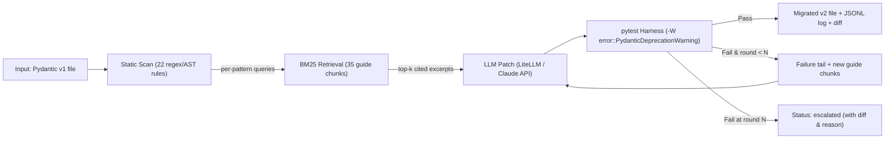

# code-migration-agent

An LLM agent that migrates Python code from **Pydantic v1 to v2**: it finds v1 patterns with a static scan, retrieves matching sections of the official migration guide (BM25 RAG), patches the code, runs `pytest` with deprecation warnings turned into errors, and feeds failures back into a bounded fix loop. An evaluation harness benchmarks the agent against a single-shot LLM call and the rule-based `bump-pydantic` baseline.

> Status: **Harness, RAG, baselines, Docker, and CI complete** — offline tests (20/20), retrieval benchmarks, and `bump-pydantic` baseline (4/14, 28.6%) are verified. The agent has passed a first real-model check (3/3 cases with `anthropic/claude-haiku-5-5`); the full 14-case LLM evaluation (`single_shot` and `agent`) is next.

## Why this exists

Version migrations are slow, file-by-file work. Rule-based AST tools handle mechanical syntax changes well (`@validator` → `@field_validator`, `class Config` → `ConfigDict`), while a single LLM call has no way to check its own output. This project tests one claim with real numbers: *a retrieval-grounded, test-driven agent loop migrates more code correctly than a single LLM call or a rule-based tool.*

## Architecture



## Eval set

`evals/cases/` holds 14 cases, each with:

| File | Purpose |
|---|---|
| `before.py` | Pydantic v1 code to migrate |
| `reference.py` | A correct v2 migration (proves the tests are achievable) |
| `test_case.py` | Behaviour tests, run under Pydantic v2 |
| `meta.json` | Patterns covered and difficulty |

Tests run with Pydantic deprecation warnings turned into errors (`-W error::pydantic.warnings.PydanticDeprecationWarning`), so code that only works through `pydantic.v1` or deprecated methods counts as a failure.

Covered patterns: `.dict()`/`.json()`, `parse_obj`/`parse_raw`, `@validator` (incl. `pre`/`always`), `@root_validator`, class-based `Config` (`orm_mode`, `allow_population_by_field_name`, `Extra`, `allow_mutation`), implicit `Optional` defaults, `regex=`/`min_items=`, `__root__`, `parse_obj_as`, `.copy()`/`.schema()`, `GenericModel`, `update_forward_refs`.

## Retrieval

The agent grounds each fix in the official [Pydantic V2 migration guide](https://github.com/pydantic/pydantic/blob/91c44cd1bfc8c7cb909cefa8395e0a720957f1d1/docs/migration.md), pinned to one commit (`data/SOURCE.md` has the URL, commit, date and MIT license).

- **Chunking:** one chunk per markdown heading (35 chunks). Each chunk keeps its heading path as its title, e.g. `Migration guide > Changes to config`, so the agent can cite where an instruction came from.
- **Search:** BM25 (`rank-bm25`), zero API cost, with a code-aware tokenizer (`parse_obj_as` is indexed as both the full identifier and split sub-tokens). Optional LiteLLM embedding search is behind `--embeddings`.
- **Whole-file vs. per-pattern queries** (`results/retrieval.json` and `results/retrieval_scan.json`, run 2026-11-14):

| Query mode | recall@1 | recall@3 | recall@5 |
|---|---:|---:|---:|
| Whole `before.py` file | 0.536 | 0.929 | 1.000 |
| One query per detected pattern (`scan.py`) | 0.893 | **1.000** | 1.000 |

## Results

<!-- RESULTS_START -->
| Mode | Model / Tool | Pass rate | Avg rounds (passed) | Total cost (USD) | Avg latency / case |
|---|---|---:|---:|---:|---:|
| Rule-based (`bump-pydantic`) | `bump-pydantic` | 4/14 (28.6%) | 0 (rule) | $0.00000 | 1.07s |
| Single-shot LLM (no RAG / no loop) | _pending LLM run_ | — | — | — | — |
| Agent (scan + BM25 RAG + pytest loop) | _pending LLM run_ | — | — | — | — |

<details>
<summary>Per-case breakdown across all 14 eval cases</summary>

| Case | Difficulty | `bump-pydantic` | `single_shot` | `agent` |
|---|---|---|---|---|
| `01_dict_json` | easy | FAIL (failed) | pending | pending |
| `02_parse_obj_raw` | easy | FAIL (failed) | pending | pending |
| `03_validator` | easy | PASS | pending | pending |
| `04_validator_pre_always` | medium | FAIL (failed) | pending | pending |
| `05_root_validator` | medium | FAIL (failed) | pending | pending |
| `06_orm_mode_config` | medium | FAIL (failed) | pending | pending |
| `07_optional_implicit_default` | medium | PASS | pending | pending |
| `08_field_regex_min_items` | easy | PASS | pending | pending |
| `09_custom_root` | hard | FAIL (failed) | pending | pending |
| `10_parse_obj_as` | medium | FAIL (failed) | pending | pending |
| `11_copy_schema` | easy | FAIL (failed) | pending | pending |
| `12_extra_forbid_frozen` | medium | FAIL (failed) | pending | pending |
| `13_generic_model` | hard | PASS | pending | pending |
| `14_forward_refs` | easy | FAIL (failed) | pending | pending |

</details>
<!-- RESULTS_END -->

> Note: `bump-pydantic` (`v0.8.0`) passes 4/14 cases (`03_validator`, `07_optional_implicit_default`, `08_field_regex_min_items`, `13_generic_model`) and leaves method rewrites (`.dict()`, `.json()`, `.parse_obj()`, `.from_orm()`, `parse_obj_as()`, `.copy()`, `.schema()`, `update_forward_refs()`) and custom `__root__` / `@root_validator` bodies unmigrated.

**Agent, first real run (step 3 check, not the full eval).** With `anthropic/claude-haiku-5-5` on 2026-11-20, the agent passed one easy and two hard cases on the first round: `01_dict_json`, `09_custom_root` (`__root__` → `RootModel`) and `13_generic_model` (`GenericModel` → `BaseModel` + `Generic`). Each round sent about 3.7k–4.4k input tokens, and the three runs cost $0.001436 in total (`results/agent_step3_check.json`). The full 14-case comparison is still pending.

## Quick start (Claude API via LiteLLM)

```bash
python -m venv .venv && source .venv/bin/activate
pip install -e ".[rag,baseline]"
python scripts/validate_cases.py      # 14/14 cases: reference passes, before fails
pytest                                # 20 unit tests (offline, no API calls)

cp .env.example .env                  # paste ANTHROPIC_API_KEY (model defaults to anthropic/claude-haiku-5-5)
python scripts/smoke_llm.py           # verify the key with 1 tiny call
python scripts/run_eval.py --mode bump_pydantic
python scripts/run_eval.py --mode single_shot
python scripts/run_eval.py --mode agent
python scripts/make_report.py --update-readme
```

### Docker

```bash
docker build -t code-migration-agent .
docker run --rm code-migration-agent
```

## Limitations & What's Next

- **Single-file scope:** `migrate_agent` currently migrates one Python file at a time; cross-module model imports are out of scope in v1.
- **Static scan coverage:** The 22 regex/AST rules target common Pydantic v1 APIs; unusual custom metaclasses rely on the test-failure retry loop.
- **Next:** Run the full 14-case LLM evaluation (`single_shot` and `agent` modes) with `anthropic/claude-haiku-5-5`, publish the comparison table, and optionally add a Streamlit demo.

## License

MIT
